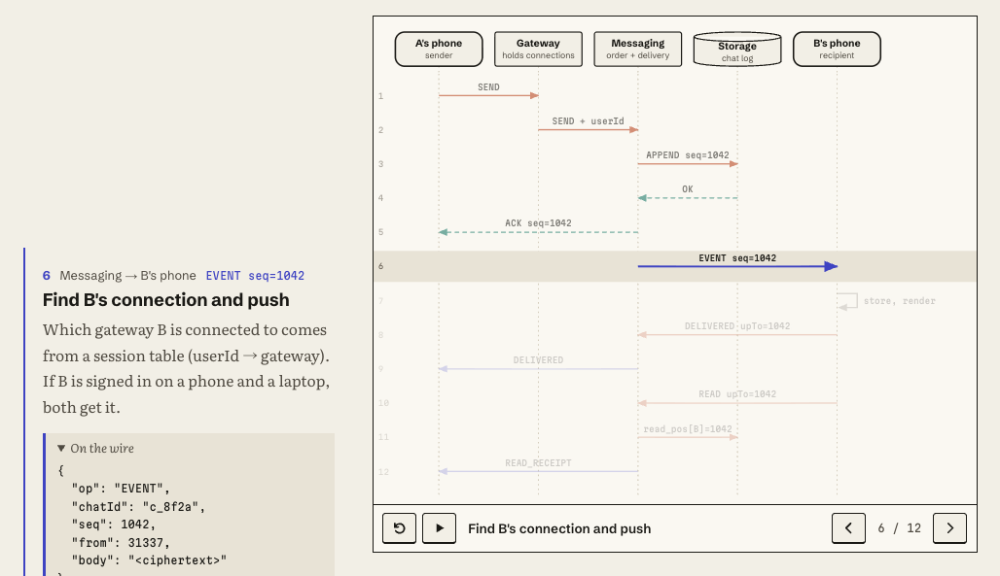

# How chat apps work

<picture>
  <source media="(prefers-color-scheme: dark)" srcset="docs/screenshot-dark.png">
  
</picture>

You tap send. Under a second later the message is on someone else's phone, and a little after that yours says Read. This site follows that one message the whole way, a frame at a time: the connection it rides on, the number the server stamps on it, the ACK that gets lost in a tunnel, the push notification that wakes a sleeping phone, the keys that keep the server from reading it.

**[Read it](https://0-draft.github.io/how-chat-apps-work/)** · [日本語](https://0-draft.github.io/how-chat-apps-work/ja/)

## What's in it

- **From send to read**: client IDs, server-assigned `seq`, and why receipts are positions, not per-message
- **The always-on connection**: DNS, TCP, TLS 1.3, auth, heartbeats, and reconnecting without a stampede
- **Why it never arrives twice**: a lost ACK, a retry, and the unique key that makes it harmless
- **Delivered while the app is closed**: APNs / FCM, notification service extensions, cursor-based sync
- **A letter the server can't read**: ECDH, AES-GCM, and what the Double Ratchet adds
- **Groups**: fan-out on read vs. write, counting readers, Sender Keys
- **Photos and video**: signed uploads, encrypted blobs, and the message as a claim ticket
- **Try it**: two phones and a server you can break on purpose
- **Real apps**: what LINE, WhatsApp, Signal, iMessage, Messenger, Telegram and Discord have published about their own systems

Scroll on a desktop and the diagram follows the text. On a phone, step through it with the buttons. Every step is a link (`#overview-6`), so you can point someone at the exact moment you mean.

## How accurate is it

The protocol in the diagrams is made up. It's a composite of what most chat apps do, with field names chosen to be readable rather than to match any one product.

Claims about real apps are a different matter. Each one lives in [`src/lib/apps.ts`](src/lib/apps.ts) next to the primary source it came from, and a weekly job checks that those sources still resolve. If something is wrong or out of date, open an issue with a link to where the vendor says otherwise.

## Running it

```sh
npm ci
npm run dev
```

`npm test` runs the unit and rendering tests. `npm run e2e` drives both languages on a desktop, a phone and in dark mode, with axe checking accessibility as it goes.

## How it's built

[Astro](https://astro.build) renders every diagram to SVG at build time, so the page reads fine with JavaScript off. A small custom element, [`<seq-player>`](src/scripts/seq-player.ts), adds the stepping. The simulator is a [Svelte](https://svelte.dev) island on top of a [pure reducer](src/lib/sim/model.ts). English and Japanese share the same step data; each string is stored as `{ en, ja }`, and the tests fail if one language is missing or the two drift apart in structure.

Type is set in Literata, Schibsted Grotesk and Martian Mono, with Zen Kaku Gothic New and Shippori Mincho B1 for Japanese.

## License

Code is [MIT](LICENSE). The writing and diagrams (`src/content/`, `src/lib/sequences/`, `src/lib/apps.ts`, `docs/`) are [CC BY 4.0](LICENSE-CONTENT): reuse them anywhere, with attribution.
